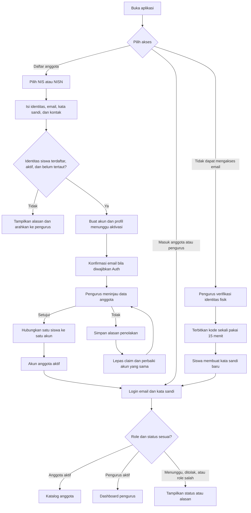
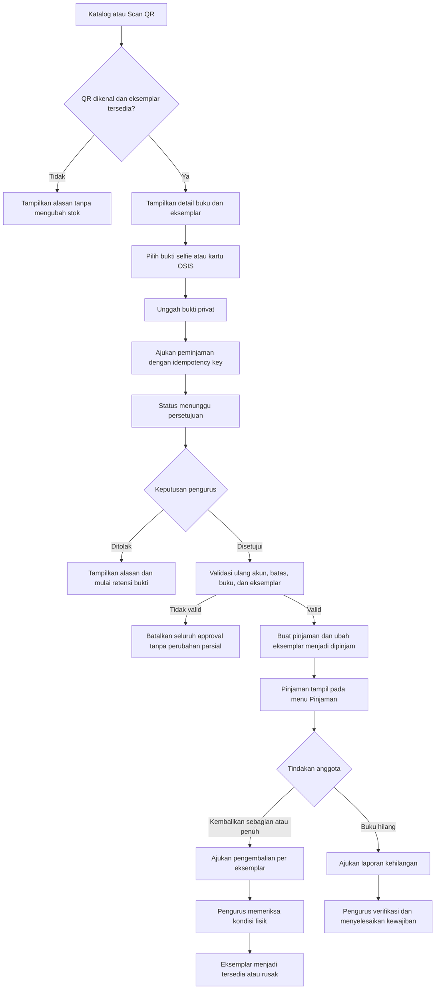
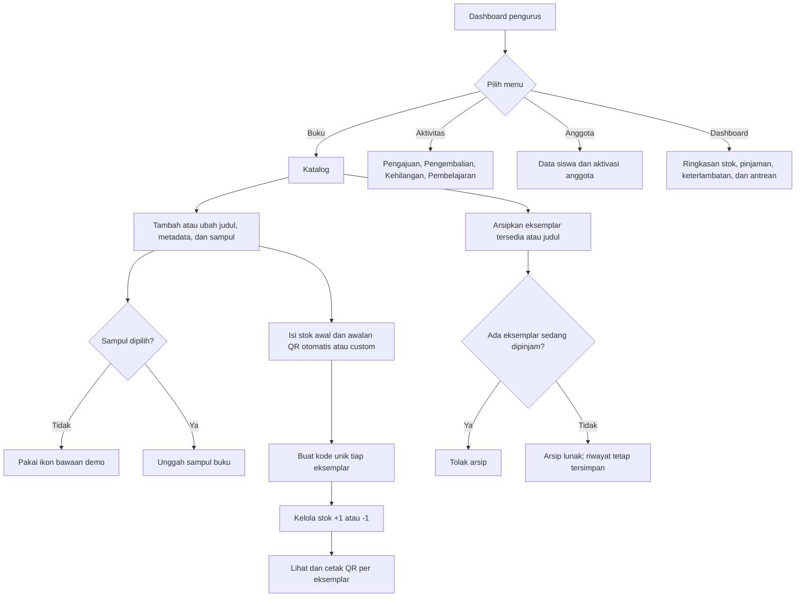
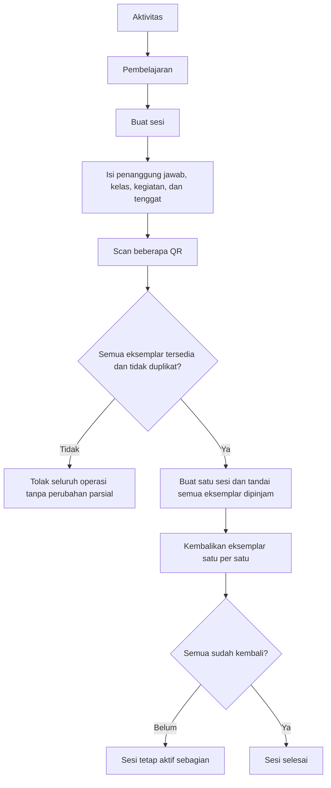

# Perpus — Product Requirements Document (PRD)

Direktori proyek: `D:\apps\Perpus`

Status: M1 dan fitur utama M2 tersedia. Alur M3 untuk pengajuan pinjaman, bukti foto privat, persetujuan, pengembalian sebagian/penuh, kehilangan, dan peminjaman pembelajaran sudah tersedia pada kode. Verifier lokal Flutter, data-access, dan SQL lulus. Regression PostgreSQL dua koneksi juga membuktikan persetujuan tidak dapat menghasilkan pinjaman aktif pada buku terarsip, dua persetujuan pada eksemplar yang sama hanya memiliki satu pemenang, dan operasi multi-item dengan urutan berbeda selesai tanpa deadlock. Kebijakan satu claim terbuka per siswa, pengajuan ulang memakai akun yang sama, dan pemulihan akun dengan verifikasi pengurus sudah diimplementasikan serta lulus pengujian lokal. Verifikasi server read-only pada 1 Oktober 2026 membuktikan migrasi penguncian dan migrasi claim/pemulihan terbaru belum diterapkan; integrasi GoTrue, Edge Function, dan Storage nyata masih harus diuji pada Supabase terisolasi. Aplikasi belum dinyatakan sebagai MVP produksi.

Keputusan terbaru pengguna: **Supabase self-hosted di server lokal/LAN melalui Nginx Proxy Manager**, login email + kata sandi, aktivasi akun melalui verifikasi admin. Kebijakan lain yang masih berupa usulan pada PRD tetap belum dianggap disetujui.

- [Menjalankan aplikasi dan mencoba alur demo](docs/development.md)
- [Arsitektur dan batas implementasi](docs/architecture.md)
- [Supabase LAN + Nginx Proxy Manager](docs/self-hosted-supabase.md)
- [Skema dan hak akses database](docs/database.md)
- [Status implementasi dan hasil pengujian](docs/implementation-status.md)

## 1. Gambaran aplikasi

Aplikasi perpustakaan berbasis Android untuk siswa dan pengurus perpustakaan. Satu aplikasi memiliki dua peran: anggota dan admin. Tampilan dan akses menyesuaikan peran setelah login. Admin dapat mengelola perpustakaan langsung dari HP.

Tujuan utama:

- Mengelola inventaris buku dan QR setiap eksemplar.
- Memproses peminjaman dengan bukti selfie atau kartu OSIS.
- Memproses pengembalian penuh maupun sebagian.
- Memantau siapa meminjam buku apa, jumlahnya, dan jatuh temponya.
- Memberikan pengingat serta menangani keterlambatan dan kehilangan.

## 2. Teknologi aplikasi

| Komponen | Pilihan | Fungsi |
| --- | --- | --- |
| Aplikasi | Flutter / Dart — dikonfirmasi | Aplikasi Android anggota dan admin |
| Backend dan database | Supabase self-hosted / PostgreSQL — dikonfirmasi | Server lokal/LAN melalui Nginx Proxy Manager |
| Autentikasi | Supabase Auth | Kredensial dan sesi pengguna |
| Hak akses | Row Level Security | Membatasi akses sesuai peran dan pemilik data |
| Penyimpanan foto | Supabase Storage privat | Bukti selfie atau kartu OSIS |
| Push notification | Firebase Cloud Messaging | Pengingat pada perangkat |
| Proses terjadwal | Scheduler dan fungsi backend | Pemeriksaan jatuh tempo dan pengiriman pengingat |

Login menggunakan email dan kata sandi. NIS/NISN hanya memvalidasi kelayakan pendaftaran. Pemulihan normal memakai tautan email Supabase Auth. Jika siswa tidak dapat mengakses email, pengurus dapat memverifikasi identitas secara langsung lalu memberikan kode pemulihan sekali pakai yang kedaluwarsa dalam 15 menit; kode mentah tidak disimpan di database.

Setelah login, header menampilkan peran **ANGGOTA** atau **PENGURUS** agar sesi aktif mudah dibedakan dari halaman masuk. Sesi anggota dan pengurus otomatis berakhir setelah 24 jam tanpa aktivitas, termasuk saat aplikasi tertutup; sentuhan atau tindakan baru memperbarui waktu aktivitas.

Referensi teknologi:

- [Flutter](https://flutter.dev/development)
- [Supabase untuk Flutter](https://supabase.com/docs/guides/getting-started/quickstarts/flutter)
- [Row Level Security](https://supabase.com/docs/guides/database/postgres/row-level-security)
- [Firebase Cloud Messaging](https://firebase.google.com/docs/cloud-messaging/flutter/receive-messages)

## 3. Fitur berdasarkan peran

| Anggota / siswa | Admin melalui mobile |
| --- | --- |
| Mendaftar menggunakan NIS atau NISN terdaftar | Menambahkan daftar siswa yang boleh mendaftar |
| Melihat katalog dan ketersediaan | Mengelola judul dan eksemplar buku |
| Scan QR untuk pengajuan peminjaman dan melihat sampul, judul, kategori, serta kode QR buku | Membuat QR setiap eksemplar |
| Memilih selfie atau kartu OSIS sebagai bukti | Memeriksa bukti dan menyetujui peminjaman |
| Melihat jumlah dan daftar buku pinjaman | Melihat pinjaman setiap siswa |
| Mengajukan pengembalian | Scan dan memvalidasi buku yang diterima |
| Menerima pengingat jatuh tempo | Mengatur durasi, batas pinjaman, jadwal pengingat |
| Melaporkan kehilangan | Mencatat kehilangan dan penyelesaiannya |

## 4. Pendaftaran berdasarkan NIS / NISN

### Data siswa ditambahkan admin terlebih dahulu

Gunakan tabel `student_registry` di database. Tabel ini menyimpan data siswa yang berhak mendaftar meskipun belum memiliki akun aplikasi.

| Data | Aturan |
| --- | --- |
| ID internal siswa | Identitas tetap dalam database |
| NIS | Unik dalam sekolah jika diisi |
| NISN | Unik jika diisi |
| Nama lengkap | Sesuai data sekolah |
| Kelas | Kelas siswa |
| Status aktif | Menentukan kelayakan pendaftaran |
| Akun tertaut | Kosong sebelum akun berhasil diaktifkan |

Minimal salah satu NIS atau NISN wajib tersedia. Simpan nomor sebagai teks agar angka nol di depan tidak hilang. Rancangan awal untuk satu sekolah. Admin menambah data secara manual; impor CSV dapat ditambahkan kemudian.

### Alur pendaftaran mandiri

1. Admin memasukkan data siswa ke database melalui aplikasi.
2. Siswa memilih daftar akun dan memilih jenis identitas: NIS atau NISN.
3. Siswa memasukkan nomor tersebut.
4. Server memeriksa apakah data tersedia, aktif, dan belum terhubung ke akun lain.
5. Jika data tidak memenuhi syarat, pendaftaran tidak dilanjutkan.
6. Jika memenuhi syarat, siswa melengkapi kredensial dan kontak lalu mengajukan aktivasi.
7. Usulan awal: admin memverifikasi kepemilikan identitas sebelum akun diaktifkan. Alternatifnya adalah kode aktivasi sekali pakai yang diberikan sekolah.
8. Server menghubungkan akun ke data siswa dan mengaktifkan akses peminjaman.

NIS/NISN bukan kata sandi atau rahasia. Mengetahui nomor siswa saja belum membuktikan bahwa pendaftar adalah pemilik identitas. Verifikasi admin atau kode aktivasi mencegah orang lain mengklaim akun siswa.

Satu siswa hanya boleh mempunyai satu akun, termasuk ketika mencoba mendaftar memakai NIS setelah pernah memakai NISN. Pemeriksaan dan penautan akun dilakukan secara atomik di server. Daftar identitas siswa tidak dapat dibaca bebas oleh pengguna yang belum login. Anggota tidak dapat mengubah perannya menjadi admin.

Hanya satu akun berstatus menunggu atau aktif yang boleh memegang claim siswa yang sama. Jika pengurus menolak pendaftaran, claim dilepas otomatis agar tidak mengunci identitas. Siswa memperbaiki dan mengajukan ulang dari akun yang sama; pembuatan akun Auth baru bukan alur utama. Pengurus wajib memeriksa identitas fisik sebelum menerbitkan kode pemulihan akses.

## 5. Inventaris dan QR

Pisahkan judul buku dengan eksemplar fisik.

Contoh: judul “Algoritma Dasar” memiliki tiga eksemplar: `BK-001`, `BK-002`, dan `BK-003`. Setiap eksemplar memiliki QR unik.

Status eksemplar: tersedia, dipinjam, rusak, atau hilang.

QR berisi identitas eksemplar, bukan informasi pribadi siswa. Scan tidak langsung mengurangi stok. Status berubah setelah transaksi peminjaman disahkan server. Jumlah tersedia dihitung berdasarkan status eksemplar.

## 6. Bukti peminjaman

Anggota memilih salah satu metode berikut:

| Metode | Proses |
| --- | --- |
| Selfie | Mengambil foto melalui kamera aplikasi |
| Kartu OSIS | Memotret kartu OSIS untuk diperiksa admin |

Asumsi awal: kartu OSIS dipakai melalui foto kartu. OCR, NFC, dan pembacaan QR pada kartu belum termasuk cakupan awal karena format kartu belum diketahui.

Bukti dihubungkan dengan akun yang sedang login dan pengajuan transaksi. Selfie adalah bukti pendukung, bukan verifikasi biometrik atau liveness otomatis. Foto kartu juga tidak menggantikan verifikasi akun.

Foto disimpan privat dan hanya dapat diakses pengguna yang berhak. Admin memilih masa simpan melalui pengaturan: 3 hari, 7 hari, 30 hari, atau 1 tahun. Aturan perhitungan dan perubahan kebijakan dijelaskan pada bagian 24.

## 7. Alur peminjaman

1. Anggota login dengan akun aktif.
2. Server memeriksa batas pinjaman serta kewajiban yang belum selesai.
3. Anggota scan QR setiap buku yang akan dipinjam.
4. Aplikasi menampilkan daftar buku dan perkiraan batas pengembalian.
5. Anggota memilih selfie atau kartu OSIS dan mengambil foto bukti.
6. Pengajuan dikirim kepada admin.
7. Admin memeriksa identitas, bukti, dan buku fisik yang diserahkan.
8. Admin menyetujui atau menolak pengajuan.
9. Saat persetujuan, server memeriksa ulang ketersediaan dan kelayakan peminjam.
10. Dalam satu transaksi database, server mencatat pinjaman aktif dan mengubah status buku.
11. Anggota menerima konfirmasi serta tanggal jatuh tempo final.

Jatuh tempo dihitung dari waktu persetujuan berdasarkan pengaturan perpustakaan. Nilai jatuh tempo disimpan pada transaksi agar perubahan durasi default tidak mengubah pinjaman lama secara diam-diam.

Pengajuan ditolak tidak mengubah stok. Server mencegah transaksi ganda akibat tombol ditekan berulang dan mencegah satu eksemplar dipinjam dua anggota secara bersamaan. Pengajuan belum disetujui tidak menjamin ketersediaan buku.

## 8. Alur pengembalian

1. Anggota membuka pinjaman aktif dan memilih buku yang akan dikembalikan.
2. Anggota mengajukan pengembalian dan menyerahkan buku fisik.
3. Admin scan QR setiap buku yang benar-benar diterima.
4. Admin memeriksa kondisi dan mengonfirmasi penerimaan.
5. Server menutup detail pinjaman terkait dan memperbarui status eksemplar.
6. Anggota melihat bukti pengembalian dan sisa pinjaman.

Rekomendasi: admin tetap scan setiap buku saat pengembalian. Anggota tidak harus scan ulang sendiri. Pengajuan anggota saja tidak boleh membuat buku dianggap sudah kembali.

Pengembalian sebagian didukung. Jika meminjam tiga buku dan mengembalikan satu, dua buku lainnya tetap aktif. Buku yang rusak tidak otomatis masuk stok tersedia. Selfie pengembalian dapat dibuat opsional karena admin memverifikasi buku fisik.

## 9. Keterlambatan dan notifikasi

Usulan jadwal yang dapat diatur admin:

- H-1 sebelum jatuh tempo.
- Hari jatuh tempo.
- Sekali sehari setelah terlambat sampai kewajiban selesai.

Backend memeriksa pinjaman secara terjadwal berdasarkan waktu server dan zona waktu sekolah. Notifikasi disimpan ke database lalu dikirim ke perangkat. Gunakan kunci deduplikasi untuk mencegah pengingat yang sama terkirim berulang saat proses dicoba ulang.

Contoh pesan:

> Ada buku yang melewati batas pengembalian. Kembalikan terlebih dahulu sebelum meminjam lagi.

Server memblokir peminjaman baru jika ada keterlambatan atau kehilangan yang belum diselesaikan. Anggota tetap bisa login, melihat pinjaman, dan mengembalikan buku.

Push notification bergantung pada izin, jaringan, dan kondisi perangkat. Aplikasi juga menyediakan kotak masuk notifikasi dan penanda keterlambatan. Pengingat dihentikan untuk buku yang telah kembali atau kewajibannya telah diselesaikan.

## 10. Kehilangan dan penelusuran anggota

Pelacakan menggunakan identitas, kontak, dan catatan transaksi. GPS tidak diperlukan dalam rancangan awal.

Admin dapat melihat nama, NIS/NISN, kelas, kontak, jumlah pinjaman, judul buku, kode eksemplar, tanggal pinjam, jatuh tempo, lama keterlambatan, dan riwayat pengembalian.

Anggota mengajukan laporan kehilangan, lalu admin memverifikasi dan menetapkan statusnya. Buku hilang tidak menjadi stok tersedia. Admin mencatat penyelesaian sesuai kebijakan sekolah, misalnya penggantian buku. Denda tidak diterapkan sebelum kebijakannya ditentukan.

## 11. Kerangka database

| Tabel | Fungsi |
| --- | --- |
| `student_registry` | Daftar siswa resmi, NIS/NISN, kelas, status, akun tertaut |
| `profiles` | Profil akun, kontak, peran, status aktivasi |
| `books` | Judul, penulis, kategori, ISBN opsional, sampul |
| `book_copies` | Eksemplar fisik, kode QR, kondisi, status |
| `loan_requests` | Pengajuan peminjaman dan keputusan admin |
| `loan_request_items` | Buku dalam pengajuan |
| `loans` | Peminjam, waktu persetujuan, admin pemroses |
| `loan_items` | Eksemplar, jatuh tempo, waktu kembali, status penyelesaian |
| `transaction_evidence` | Metode bukti, file privat, kebijakan retensi tersalin, waktu mulai retensi, jadwal dan status penghapusan |
| `return_requests` | Pengajuan pengembalian |
| `return_request_items` | Buku yang dikembalikan dan hasil pemeriksaan |
| `loss_reports` | Laporan kehilangan dan penyelesaian |
| `notifications` | Pesan, penerima, status baca, deduplikasi |
| `device_tokens` | Token perangkat untuk push notification |
| library_settings | Durasi, batas pinjaman, zona waktu, pengingat, kebijakan retensi foto |
| 
eport_archives | Periode, snapshot laporan, pembuat, versi, waktu pengesahan, lokasi file privat |
| `audit_logs` | Catatan tindakan admin dan perubahan penting |

Relasi utama:

- Satu siswa terhubung maksimal ke satu akun.
- Satu judul mempunyai banyak eksemplar.
- Satu anggota mempunyai banyak transaksi.
- Satu transaksi mempunyai banyak detail buku.
- Satu eksemplar hanya mempunyai maksimal satu pinjaman yang belum selesai.

Aturan akses diterapkan di server/database, bukan hanya menyembunyikan tombol. Anggota hanya dapat mengakses datanya sendiri. Kunci layanan backend tidak disertakan dalam aplikasi Android.

## 12. App flow

App flow berikut mengikuti menu dan proses yang sudah tersedia pada aplikasi. Tampilan dasar demo tetap dipertahankan: pengurus memakai **Dashboard, Buku, Aktivitas, Anggota**, sedangkan anggota memakai **Katalog, Scan, Akun, Pinjaman**.

### Masuk dan aktivasi anggota



Satu siswa hanya boleh memiliki satu claim terbuka, baik berstatus menunggu maupun aktif. Penolakan melepaskan claim secara otomatis, lalu siswa mengajukan ulang memakai akun yang sama. Kode pemulihan hanya diterbitkan pengurus aktif setelah verifikasi langsung, berlaku sekali, dibatasi percobaan, dan tidak membuka endpoint pencarian identitas siswa.

### Alur anggota dan peminjaman



Scan QR tidak langsung mengurangi stok. Stok berubah hanya setelah persetujuan backend berhasil. Pengembalian sebagian menutup eksemplar yang diterima saja; pinjaman lain tetap aktif.

### Alur pengurus, katalog, dan inventaris



Pengurangan stok mengarsipkan satu eksemplar yang tersedia dan tidak menghapus riwayat. Kode QR setiap eksemplar berbeda, misalnya `BTKJ-ASJ-01` sampai `BTKJ-ASJ-50` untuk 50 eksemplar dengan awalan tersebut.

### Peminjaman pembelajaran oleh pengurus



### Status pembuktian flow

| Cakupan | Status saat ini |
| --- | --- |
| Navigasi anggota/pengurus, katalog, QR, CRUD, stok, pengajuan, pengembalian, kehilangan, dan pembelajaran | Tersedia pada kode aplikasi |
| Flutter analyze, 9 widget test, 10 data-access test, SQL/RLS/RPC fixture, guard integrasi, dan helper kode pemulihan | Lulus lokal pada 1 Oktober 2026 |
| Approval melawan archive, dua approval pada copy sama, dan multi-item berurutan berbeda | Lulus pada PostgreSQL sementara dengan dua koneksi |
| Race dua signup atas siswa yang sama | Lulus pada PostgreSQL sementara dengan dua koneksi; tepat satu claim menunggu |
| Signup/login/reset/pemulihan terbantu melalui GoTrue/Edge Function nyata dan bukti foto melalui Storage API nyata | Belum diuji pada Supabase terisolasi |
| Migrasi penguncian serta claim/pemulihan terbaru pada server aktif | Belum diterapkan; preflight read-only menemukan 0 kelompok claim ganda |
| Notifikasi/pengingat, retensi terjadwal, laporan PDF/CSV dan arsip tahunan | Tahap M4; belum dianggap selesai |

## 13. Struktur monorepo

Seluruh aplikasi, paket bersama, backend, dan dokumentasi dikelola dalam satu repository Git di `D:\apps\Perpus`. Aplikasi Android tetap satu aplikasi dengan dua peran: anggota dan admin.

```text
Perpus/
  README.md
  .gitignore
  apps/
    mobile/
      pubspec.yaml
      android/
      assets/
      lib/
        main.dart
        app/                 # Routing, tema, inisialisasi
        core/                # Konfigurasi khusus aplikasi
        features/
          auth/
          students/
          catalog/
          inventory/
          loans/
          returns/
          notifications/
          admin/
      test/                  # Pengujian aplikasi
      integration_test/      # Pengujian alur lengkap Android
  packages/
    domain/
      pubspec.yaml
      lib/                   # Model dan aturan domain Dart bersama
      test/
    data_access/
      pubspec.yaml
      lib/                   # Repository dan integrasi layanan untuk klien
      test/
    ui_kit/
      pubspec.yaml
      lib/                   # Tema dan widget Flutter bersama
      test/
  supabase/
    config.toml
    migrations/              # Skema, aturan akses, fungsi transaksi SQL
    functions/               # Fungsi server dan pengingat
    tests/                   # Validasi aturan akses dan transaksi backend
    seed.sql                 # Data contoh untuk pengembangan
  docs/
    architecture.md
    database.md
    app-flow.md
    development.md
  scripts/                   # Otomasi pengembangan repository
```

### Batas tanggung jawab

| Lokasi | Tanggung jawab |
| --- | --- |
| `apps/mobile` | Aplikasi Android, navigasi, fitur anggota dan admin |
| `packages/domain` | Model dan aturan domain yang tidak bergantung pada UI atau Supabase |
| `packages/data_access` | Akses data klien dan implementasi repository; bergantung pada domain |
| `packages/ui_kit` | Komponen tampilan bersama tanpa akses langsung ke database |
| `supabase` | Sumber skema database, otorisasi, transaksi, dan proses server |
| `docs` | Dokumentasi teknis dan panduan pengembangan |
| `scripts` | Perintah bantu untuk pekerjaan lintas bagian repository |

Aplikasi menggunakan paket lokal dalam `packages`. Paket bersama tidak boleh mengimpor kode dari `apps/mobile`. Model Dart digunakan oleh kode Dart; fungsi backend memiliki implementasi dan validasinya sendiri. Aturan transaksi serta otorisasi tetap ditegakkan di server meskipun klien memiliki validasi untuk antarmuka.

Pengujian ditempatkan bersama aplikasi, paket, atau backend yang diuji. Dependensi Flutter/Dart dicatat pada `pubspec.yaml` masing-masing. Konfigurasi rahasia backend tidak masuk repository maupun paket klien; data contoh menggunakan identitas fiktif.

Struktur di atas merupakan target monorepo. Aplikasi mobile dan tiga paket bersama sudah dibuat; folder backend berisi fondasi migrasi dan pengujian M2. Folder fitur, fungsi server, serta integration_test akan ditambahkan saat tahap terkait diimplementasikan.

## 14. Workflow implementasi

1. Gunakan Flutter yang telah dikonfirmasi pengguna; periksa kesiapan Flutter SDK dan Android SDK.
2. Siapkan monorepo, aplikasi Android di `apps/mobile`, paket bersama di `packages`, backend di `supabase`, dan konfigurasi lingkungan.
3. Buat skema siswa, akun, peran, dan aturan akses.
4. Implementasikan daftar siswa admin serta pendaftaran dan aktivasi anggota.
5. Implementasikan katalog, inventaris, dan QR unik.
6. Implementasikan peminjaman dengan pilihan selfie atau kartu OSIS.
7. Implementasikan persetujuan admin dan pembaruan stok atomik.
8. Implementasikan pengembalian sebagian dan penuh.
9. Implementasikan keterlambatan, pembatasan pinjaman, dan notifikasi.
10. Implementasikan laporan kehilangan dan riwayat admin.
11. Uji alur lengkap di Android.

## 15. Skenario pengujian utama

- NIS/NISN yang belum ditambahkan admin tidak dapat mengaktifkan akun.
- NIS dan NISN milik siswa yang sama tidak menghasilkan dua akun.
- Nomor siswa saja tidak cukup untuk mengambil alih identitas.
- Anggota tidak dapat mengakses bukti atau pinjaman anggota lain.
- Anggota tidak dapat menaikkan peran sendiri menjadi admin.
- Scan berulang tidak menggandakan item pengajuan.
- Persetujuan bersamaan tidak meminjamkan eksemplar yang sama dua kali.
- Pengembalian sebagian hanya menutup buku yang diterima.
- Buku rusak/hilang tidak dihitung sebagai tersedia.
- Keterlambatan tetap memblokir pinjaman meskipun notifikasi tidak diterima.
- Pengingat tidak berulang untuk periode yang sama dan berhenti setelah selesai.

## 16. Keputusan yang masih perlu ditetapkan

- Metode login dan pemulihan akun.
- Aktivasi melalui pemeriksaan admin atau kode dari sekolah.
- Lama pinjaman, batas jumlah buku, dan jam jatuh tempo.
- Format kartu OSIS sekolah.
- Kebijakan buku rusak, hilang, dan denda jika ada.
- Nilai awal masa simpan foto untuk lembaga; pilihan 3 hari, 7 hari, 30 hari, atau 1 tahun sudah ditetapkan sebagai fitur pengaturan.

Dokumentasi ini mencatat kebutuhan yang sudah dibahas dan rekomendasi awal untuk ditinjau sebelum implementasi.

## 17. Palet warna dan pedoman UI/UX

Palet berikut ditetapkan untuk aplikasi Android anggota dan admin. Rancangan awal menggunakan tampilan terang dengan warna hijau gelap sebagai aksi utama.

| Warna | Token desain | Penggunaan |
| --- | --- | --- |
| `#2D3939` | `textPrimary` | Teks utama, judul, ikon utama |
| `#5B6972` | `textSecondary` | Teks pendukung, label, ikon nonaktif secara visual |
| `#CFD8DF` | `surface` | Latar utama, bidang input, teks pada tombol gelap |
| `#9DADA3` | `surfaceAccent` | Kartu, kelompok informasi, latar pilihan atau penanda lembut |
| `#273E20` | `primary` | Tombol utama, navigasi terpilih, fokus, aksen identitas aplikasi |

### Kombinasi warna

- Latar utama `#CFD8DF` dengan teks `#2D3939`.
- Kartu `#9DADA3` dengan teks `#2D3939` atau `#273E20`.
- Tombol utama `#273E20` dengan teks dan ikon `#CFD8DF`.
- Teks pendukung `#5B6972` digunakan di atas `#CFD8DF`; jangan gunakan sebagai teks kecil di atas `#9DADA3` karena kontrasnya lebih rendah.
- Tombol sekunder menggunakan latar `#CFD8DF`, garis tepi dan teks `#273E20`.
- Status terpilih ditandai melalui warna, ikon, dan bentuk/garis penanda agar tidak bergantung pada warna saja.

### Susunan layar anggota

1. Beranda: ringkasan jumlah pinjaman, jatuh tempo terdekat, dan tombol Scan Buku.
2. Katalog: pencarian, filter, serta ketersediaan buku.
3. Pinjaman: daftar buku, tanggal jatuh tempo, status, dan pengajuan pengembalian.
4. Profil: identitas siswa, informasi akun, dan pengaturan.

Navigasi bawah memuat Beranda, Katalog, Pinjaman, dan Profil. Notifikasi dapat dibuka dari ikon di bagian atas. Scan Buku menjadi aksi utama yang mudah dijangkau pada beranda.

### Susunan layar admin

1. Dashboard: ringkasan buku tersedia, pinjaman aktif, keterlambatan, dan pengajuan menunggu.
2. Buku: katalog, eksemplar, QR, dan kondisi buku.
3. Transaksi: persetujuan peminjaman, scan pengembalian, dan laporan kehilangan.
4. Anggota: daftar siswa, aktivasi akun, dan pinjaman per siswa.

Pengaturan perpustakaan, masa simpan foto, Laporan & Arsip, dan profil admin diakses melalui menu pada dashboard. Gunakan komponen visual yang sama dengan anggota agar pengalaman tetap konsisten.

### Pedoman interaksi

- Gunakan satu aksi utama yang jelas per tahap transaksi.
- Tampilkan judul buku, kode eksemplar, dan jatuh tempo secara jelas sebelum konfirmasi.
- Pilihan bukti Selfie dan Kartu OSIS ditampilkan sebagai dua opsi dengan label dan ikon.
- Tampilkan progres ketika mengunggah bukti atau menyimpan transaksi; cegah pengiriman ganda.
- Sediakan keadaan memuat, kosong, gagal, dan berhasil dengan pesan serta tindakan lanjutan yang jelas.
- Status terlambat atau hilang memakai ikon dan teks eksplisit. Palet ini tidak menyediakan warna merah/kuning semantik; warna status tambahan perlu ditetapkan jika dibutuhkan.
- Pastikan area sentuh memadai, teks mengikuti pengaturan ukuran perangkat, serta kontras diperiksa pada komponen final termasuk keadaan fokus dan nonaktif.
- Simpan token warna dan komponen bersama pada `packages/ui_kit` agar seluruh layar konsisten.

Tema dan layar demo anggota/admin telah diimplementasikan menggunakan palet ini. Integrasi backend dan pengujian penerimaan produksi masih diperlukan.

## 18. Cakupan dan prioritas MVP

### Masalah dan hasil yang dituju

Pencatatan manual menyulitkan pengurus mengetahui ketersediaan buku, penanggung jawab tiap eksemplar, dan pinjaman lewat jatuh tempo. Produk harus menyediakan catatan transaksi yang dapat ditelusuri serta mempercepat pemeriksaan peminjaman dan pengembalian dari HP.

Pengguna utama adalah siswa peminjam dan pengurus perpustakaan. Cakupan awal satu sekolah, antarmuka Bahasa Indonesia, dan satu aplikasi Android dengan dua peran.

### Prioritas

| Prioritas | Cakupan | Ketentuan |
| --- | --- | --- |
| P0: wajib MVP | Data siswa, pendaftaran dan aktivasi, login, hak akses | Akun hanya aktif untuk siswa terverifikasi |
| P0: wajib MVP | Katalog, eksemplar, QR, pencarian | Identitas eksemplar unik |
| P0: wajib MVP | Pengajuan, pilihan bukti, persetujuan admin | Transaksi dan stok konsisten |
| P0: wajib MVP | Pengembalian penuh/sebagian | Penerimaan fisik diverifikasi admin |
| P0: wajib MVP | Daftar pinjaman per siswa, keterlambatan, pembatasan | Penegakan di backend |
| P0: wajib MVP | Notifikasi dalam aplikasi dan push terjadwal | Pengingat tidak bergantung pada aplikasi terbuka |
| P0: wajib MVP | Laporan kehilangan dan penyelesaian manual oleh admin | Jejak perubahan tersimpan |
| P0: wajib MVP | Pengaturan retensi foto dan penghapusan terjadwal | Bukti transaksi aktif tetap terlindungi |
| P0: wajib MVP | Laporan PDF/CSV dan arsip tahunan | Snapshot berversi untuk kebutuhan lembaga |
| P1: lanjutan | Impor siswa CSV, ekspor Excel berformat, cetak label QR massal | Setelah alur utama stabil |

Di luar MVP: iOS/web, banyak sekolah, GPS, pengenalan wajah/liveness, OCR/NFC kartu, pembayaran denda otomatis, reservasi buku, perpanjangan pinjaman, dan transaksi offline. Ini tidak mengurangi kebutuhan P0 meskipun pengerjaannya bertahap.

## 19. Kebutuhan dan kriteria penerimaan

| ID | Kebutuhan | Kriteria penerimaan |
| --- | --- | --- |
| FR-01 | Admin mengelola siswa | Admin dapat menambah siswa dengan minimal NIS atau NISN; nomor duplikat ditolak; anggota tidak dapat mengubah daftar resmi |
| FR-02 | Siswa mendaftar mandiri | Identitas yang tidak terdaftar/tidak aktif ditolak; NIS dan NISN siswa yang sama tidak menghasilkan dua akun aktif; verifikasi kepemilikan diperlukan |
| FR-03 | Login dan akses peran | Sesi anggota tidak dapat menjalankan tindakan admin melalui UI maupun panggilan backend langsung; akun belum aktif tidak dapat meminjam |
| FR-04 | Inventaris | Admin dapat membuat judul dan eksemplar; QR memetakan satu eksemplar; jumlah tersedia sama dengan jumlah eksemplar berstatus tersedia |
| FR-05 | Bukti transaksi | Pengguna memilih selfie atau foto kartu OSIS; pengajuan hanya dapat dikirim setelah bukti tersimpan; bukti tidak dapat diakses anggota lain |
| FR-06 | Peminjaman | Persetujuan memvalidasi ulang seluruh buku dan batas peminjam; satu buku tidak bisa memiliki dua pinjaman terbuka; pengulangan permintaan tidak menggandakan transaksi |
| FR-07 | Pengembalian | Scan admin menutup hanya buku yang diterima; pengembalian satu dari tiga buku menyisakan dua pinjaman; scan buku yang tidak terkait ditolak |
| FR-08 | Keterlambatan | Setelah jatuh tempo server memblokir pinjaman baru; akses pengembalian tetap terbuka; setelah semua kewajiban selesai pembatasan terkait dicabut |
| FR-09 | Pengingat | Pengujian jadwal menghasilkan satu pesan per pinjaman/periode; pesan tersimpan dalam aplikasi; proses berhenti setelah kewajiban selesai |
| FR-10 | Monitoring admin | Admin dapat membuka siswa dan melihat jumlah buku aktif, judul, eksemplar, jatuh tempo, serta status masing-masing |
| FR-11 | Kehilangan | Laporan anggota tidak otomatis menutup kewajiban; admin memverifikasi dan mencatat penyelesaian; buku hilang tidak otomatis tersedia |
| FR-12 | Pengaturan | Durasi dan batas pinjaman dapat diubah admin; perubahan default tidak mengubah jatuh tempo pinjaman lama |
| FR-13 | Retensi foto | Admin dapat memilih 3/7/30 hari atau 1 tahun; bukti aktif tidak terhapus; file yang jatuh tempo dihapus tanpa menghapus transaksi; perubahan pengaturan tercatat |
| FR-14 | Laporan dan arsip | Admin dapat mengekspor PDF/CSV per periode; snapshot yang disahkan tetap sama setelah data operasional berubah; koreksi membuat versi baru; anggota tidak dapat mengakses arsip lembaga |

Usulan perilaku persetujuan MVP: semua item dalam satu pengajuan disetujui secara atomik. Bila satu item tidak tersedia, tidak ada item yang berubah menjadi dipinjam; anggota memperoleh informasi untuk memperbaiki pengajuan.

## 20. Status dan kasus khusus

| Entitas | Alur status yang direncanakan |
| --- | --- |
| Akun | Menunggu verifikasi → aktif; penolakan disertai alasan dan jalur pengajuan ulang; admin dapat menonaktifkan akun |
| Pengajuan pinjaman | Menunggu → disetujui / ditolak / dibatalkan anggota sebelum persetujuan |
| Detail pinjaman | Dipinjam → dikembalikan atau kehilangan terverifikasi → diselesaikan admin |
| Pengajuan pengembalian | Menunggu → selesai / ditolak dengan alasan |
| Laporan kehilangan | Dilaporkan → diverifikasi / ditolak → diselesaikan |

Terlambat dihitung dari jatuh tempo dan kewajiban yang masih terbuka, bukan status yang menghapus informasi hilang atau rusak. Status transaksi induk diturunkan dari detail buku; pengembalian sebagian tidak menutup keseluruhan transaksi.

- Akun nonaktif tidak dapat meminjam lagi; admin tetap dapat memproses pengembalian dan melihat kewajibannya.
- Data siswa, buku, atau transaksi yang memiliki riwayat diarsipkan, bukan dihapus hingga riwayat kehilangan referensi.
- Izin kamera ditolak: tampilkan penjelasan dan akses pengaturan; jangan mengirim bukti kosong.
- Jaringan putus: jangan tampilkan sukses sebelum server mengonfirmasi; saat mencoba ulang gunakan identitas permintaan yang sama untuk mencegah duplikasi.
- Upload berhasil tetapi pengajuan gagal: sediakan pengulangan aman dan pembersihan file yatim oleh backend.
- QR tidak dikenal atau buku tidak tersedia: tampilkan alasan dan jangan tambahkan ke pengajuan.
- Pengingat pada layar kunci menggunakan pesan umum; rincian siswa dan bukti tidak dimasukkan ke push notification.

## 21. Kebutuhan kualitas dan definisi selesai

- Semua perubahan stok dan transaksi dilakukan secara atomik serta menggunakan waktu server.
- Hak akses database dan penyimpanan diuji dengan dua akun anggota dan satu akun admin.
- Log mencatat pelaku, waktu, dan tindakan penting tanpa menyimpan kata sandi, token, atau isi foto.
- Operasi transaksi MVP memerlukan internet; kondisi offline ditampilkan secara jelas.
- Daftar panjang menggunakan pagination; pencarian tidak mengambil seluruh data sekaligus.
- Target UX awal: layar daftar utama memuat dalam 3 detik pada perangkat dan jaringan uji yang disepakati. Target ini belum diukur; profil perangkat, jaringan, dan ukuran data uji dicatat sebelum pengujian penerimaan.
- Form, navigasi, dan tombol tetap dapat dipakai saat ukuran teks diperbesar; status menggunakan teks/ikon selain warna.
- Proses pengingat mencatat keberhasilan/kegagalan dan dapat dicoba ulang tanpa pesan ganda. Penerimaan push pada semua kondisi perangkat tidak dijanjikan.

MVP dinyatakan selesai ketika seluruh FR-01 sampai FR-14 lolos pengujian, aplikasi Android dapat dipasang, alur anggota/admin diuji pada perangkat, serta skenario kegagalan dan akses ilegal pada bagian 15 tidak menghasilkan perubahan data yang salah. Panduan setup dan konfigurasi lingkungan tersedia tanpa rahasia di repository. Tampilan demo dengan data lokal saja belum dianggap MVP selesai.

## 22. Kesiapan pengembangan dan keputusan terbuka

Fondasi dapat dimulai: struktur monorepo, tema sesuai palet, navigasi dua peran, komponen UI, kontrak model, dan tampilan dengan data contoh. Data contoh harus diberi penanda agar tidak disalahartikan sebagai integrasi backend yang sudah berjalan.

| Keputusan / kebutuhan | Usulan awal | Kapan diperlukan |
| --- | --- | --- |
| Framework — dikonfirmasi | Flutter / Dart; tugas kuliah membebaskan framework | Tidak lagi menjadi keputusan terbuka |
| Login dan pemulihan — dikonfirmasi | Email + kata sandi; NIS/NISN untuk validasi pendaftaran | Uji alur konfirmasi signup dan callback pemulihan dengan akun terdaftar |
| Aktivasi akun — dikonfirmasi | Pemeriksaan admin | Sebelum alur pendaftaran terintegrasi |
| Durasi dan batas buku | Contoh pengembangan: 7 hari dan 3 buku, dapat diubah admin | Sebelum uji aturan peminjaman; bukan kebijakan final sekolah |
| Jatuh tempo dan pengingat | Zona waktu sekolah; H-1, hari H, lalu harian | Jam tepat dan zona waktu harus ditetapkan sebelum scheduler aktif |
| Kartu OSIS | Foto dari kamera | Contoh format kartu diperlukan sebelum memfinalkan petunjuk pengambilan foto |
| Kehilangan dan kerusakan | Penyelesaian manual oleh admin; tanpa denda otomatis | Sebelum fitur penyelesaian digunakan secara nyata |
| Retensi bukti — pilihan dikonfirmasi | Admin memilih 3 hari, 7 hari, 30 hari, atau 1 tahun | Lembaga memilih nilai awal sebelum menyimpan foto sungguhan; lihat bagian 24 |
| Layanan eksternal | Supabase self-hosted LAN + Nginx Proxy Manager dikonfirmasi; Firebase untuk push masih perlu disiapkan | Sebelum integrasi backend dan push; kredensial tidak dicatat dalam PRD |
| Admin pertama | Disiapkan melalui proses backend terkontrol | Sebelum uji aktivasi anggota; tidak tersedia pendaftaran admin publik |
| Perangkat Android | Versi minimum dan perangkat uji belum ditetapkan | Saat memilih versi SDK dan dependensi |

Semua usulan pada tabel ini adalah asumsi kerja yang perlu diputuskan pada tahap terkait, bukan persetujuan pengguna. Keputusan yang belum memengaruhi tahap berjalan tidak harus menghentikan pekerjaan fondasi.

## 23. Tahap penyerahan dan ukuran keberhasilan

| Tahap | Hasil yang dapat ditinjau |
| --- | --- |
| M1 — Fondasi | Monorepo, tema, navigasi, layar anggota/admin dengan data contoh |
| M2 — Identitas dan inventaris | Pendaftaran terverifikasi, akses peran, siswa, buku, QR terhubung backend |
| M3 — Transaksi | Bukti, persetujuan atomik, pengembalian sebagian/penuh |
| M4 — Pemantauan dan arsip | Pinjaman per siswa, keterlambatan, kehilangan, notifikasi, retensi foto, laporan dan arsip tahunan |
| M5 — Validasi MVP | APK uji, hasil kriteria penerimaan, dan panduan setup |

Ukuran keberhasilan penerimaan: seluruh kebutuhan P0 lolos; tidak ada pinjaman ganda pada pengujian bersamaan; seluruh upaya akses lintas anggota pada pengujian ditolak; pengembalian sebagian mempertahankan stok yang benar; pengingat dalam aplikasi tidak terduplikasi pada percobaan ulang. Kecepatan operasional dan kemudahan penggunaan dievaluasi melalui uji siswa/admin setelah prototipe tersedia; belum ada klaim peningkatan yang diukur.

## 24. Pengaturan masa simpan foto

Pilihan retensi dikonfirmasi pengguna dan tersedia pada Pengaturan → Penyimpanan Bukti:

| Pilihan | Perhitungan setelah kewajiban transaksi selesai |
| --- | --- |
| 3 hari | Waktu selesai + 3 hari |
| 7 hari | Waktu selesai + 7 hari |
| 30 hari | Waktu selesai + 30 hari |
| 1 tahun | Waktu selesai + 1 tahun kalender; bukan otomatis akhir tahun ajaran |

“Tahunan” ditafsirkan sebagai 1 tahun; pada tanggal 29 Februari, tanggal akhir mengikuti hari terakhir Februari tahun berikutnya. Lembaga memilih nilai awal sebelum penggunaan nyata. Untuk data contoh, 30 hari dapat dipakai sebagai usulan awal.

Aturan implementasi yang diusulkan:

1. Kebijakan retensi disalin ke bukti saat pengajuan dikirim agar setiap bukti memiliki aturan yang dapat ditelusuri.
2. Hitungan dimulai setelah seluruh buku dan kewajiban dalam transaksi selesai. Pengembalian sebagian, keterlambatan, atau kehilangan yang belum selesai tidak memulai penghapusan.
3. Untuk pengajuan ditolak/dibatalkan, hitungan dimulai pada waktu keputusan tersebut. Upload yatim yang tidak pernah menjadi pengajuan memiliki prosedur pembersihan terpisah.
4. Perubahan pengaturan berlaku untuk pengajuan baru. Bukti lama mempertahankan kebijakannya. Penerapan massal ke bukti lama tidak termasuk MVP agar perubahan pengaturan tidak langsung menghapus arsip foto yang tidak diperkirakan admin.
5. Layar pengaturan menjelaskan kapan hitungan dimulai dan cakupan perubahan. Hanya admin dapat menyimpan pengaturan; perubahan mencatat nilai lama, nilai baru, pelaku, dan waktu.
6. Backend memeriksa kelayakan penghapusan minimal sekali sehari, memvalidasi ulang bahwa kewajiban sudah selesai, dan menghapus file beserta salinan turunannya di penyimpanan aplikasi. Status berhasil hanya dicatat setelah penghapusan berhasil; kegagalan dicoba ulang secara aman.
7. Riwayat transaksi tetap tersedia bersama jenis bukti dan waktu penghapusan. Tampilan menunjukkan “Foto telah dihapus sesuai kebijakan penyimpanan”, bukan tautan rusak.
8. Kebijakan cadangan penyimpanan perlu didokumentasikan saat layanan dipasang; penghapusan dari penyimpanan aktif tidak dianggap otomatis menghapus semua backup.

Pengujian mencakup seluruh pilihan durasi, batas tanggal/tahun kabisat, transaksi masih aktif, pengembalian sebagian, kehilangan belum selesai, pengajuan ditolak, perubahan pengaturan, dan pengulangan pekerjaan penghapusan.

## 25. Laporan dan arsip lembaga

Tujuan: menyediakan data pendukung penilaian kepala sekolah dan evaluasi perpustakaan. Laporan aplikasi merupakan bahan pendukung; format penilaian final menyesuaikan kebutuhan lembaga.

### Output MVP

- PDF: profil perpustakaan, periode, ringkasan, tabel/statistik aktivitas, serta ruang nama dan tanda tangan pihak pengesah.
- CSV: rekap inventaris dan transaksi untuk pengolahan lanjutan. Ekspor Excel berformat merupakan pengembangan berikutnya.
- Rekap: jumlah judul/eksemplar, penambahan, kondisi, kehilangan, peminjaman, pengembalian, keterlambatan, dan penyelesaian kewajiban.
- Statistik: peminjam aktif, buku paling sering dipinjam, aktivitas per bulan dan kelas.

Admin memilih tahun kalender, tahun ajaran, atau rentang tanggal. Awal/akhir tahun ajaran ditentukan lembaga. Definisi statistik harus jelas: aktivitas dihitung berdasarkan waktu kejadian dalam periode, sedangkan stok dan kewajiban terbuka dihitung pada batas akhir periode. Jumlah transaksi dan jumlah eksemplar ditampilkan sebagai ukuran berbeda.

### Alur arsip

1. Admin memilih periode dan membuat pratinjau laporan.
2. Server menghasilkan laporan dari snapshot data yang konsisten.
3. Admin meninjau dan mengesahkan versi untuk arsip internal aplikasi.
4. Sistem menyimpan snapshot, file PDF/CSV, identitas laporan, periode, waktu pembuatan/pengesahan, pembuat, versi, dan checksum file.
5. File dapat diunduh untuk penyimpanan lembaga dan cadangan.
6. Koreksi menghasilkan versi baru dengan alasan dan hubungan ke versi sebelumnya. Versi lama tetap tersedia dan tidak ditimpa.

Pengesahan internal aplikasi tidak dianggap tanda tangan elektronik tersertifikasi. PDF menyediakan ruang tanda tangan sesuai kebutuhan lembaga.

Riwayat perubahan inventaris dan transaksi perlu tersedia sejak awal untuk menghitung kondisi pada akhir periode. Data yang tidak pernah dicatat sebelum aplikasi digunakan tidak boleh diklaim sebagai riwayat lengkap. Kelas siswa dan identitas buku yang relevan pada waktu transaksi disimpan agar perubahan kelas/judul tidak merusak rekap historis.

Foto selfie/kartu OSIS tidak dilampirkan rutin ke laporan. Arsip menyimpan catatan transaksi dan rekap sehingga penghapusan foto tidak mengubah laporan yang disahkan. File arsip privat hanya dapat diakses admin yang berwenang; unduhan dicatat. Masa simpan arsip laporan ditetapkan terpisah oleh lembaga dan tidak mengikuti pilihan retensi foto. MVP tidak menghapus arsip laporan otomatis berdasarkan pengaturan foto.

Format institusi, masa simpan arsip, dan penanggung jawab pengesahan perlu ditentukan sebelum digunakan untuk pelaporan resmi. Uji penerimaan meliputi batas periode, kecocokan total dengan detail, stok historis, akses admin, serta snapshot yang tetap identik setelah data operasional berubah.
