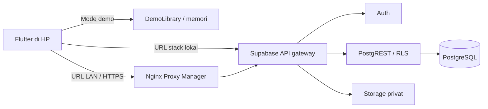

# Arsitektur dan keputusan

## Keputusan terbaru - 6 Oktober 2026

Peminjaman anggota memerlukan persetujuan pengurus setelah pemeriksaan siswa dan buku fisik. Aplikasi memakai `submit_loan_request`, kemudian pengurus memakai `review_loan_request`. Pengajuan belum mengurangi stok. Migrasi `202610060001_staff_approval_required.sql` menolak pengajuan ganda anggota/QR yang masih pending, memvalidasi jenis bukti null, dan mencabut akses klien ke `borrow_books`. Pinjaman lama tidak diubah. Migrasi sudah diterapkan dan diverifikasi pada server aktif. Masa kedaluwarsa otomatis belum ditentukan.

Keputusan 28 September 2026: Flutter Android; Supabase self-hosted pada server LAN; Nginx Proxy Manager sebagai reverse proxy; login email + kata sandi; aktivasi anggota oleh admin. Pilihan ini dikonfirmasi pengguna. Domain, alamat server, SMTP, Firebase, serta kebijakan operasional sekolah belum tersedia.

## Implementasi saat ini

- `apps/mobile`: login Supabase; katalog anggota; scan QR buku; pengelolaan katalog, inventaris, dan anggota; pengajuan dan persetujuan pengurus dengan bukti foto privat, pengembalian; kehilangan; peminjaman pembelajaran; pengajuan ulang akun ditolak; dan pemulihan akses terbantu. Deteksi wajah dijalankan lokal di perangkat dan tidak melakukan pencocokan identitas atau liveness. Mode demo tetap terpisah dan berlabel.
- `packages/domain`: model buku, eksemplar, siswa, pengajuan, pinjaman dan pemeriksaan kelayakan.
- `packages/data_access`: `DemoLibrary`, penyimpanan sementara dalam memori. Hilang saat proses aplikasi berhenti. Ini bukan implementasi transaksi database atau otorisasi.
- `packages/ui_kit`: lima token warna PRD, tema dan komponen bersama.
- `supabase/migrations`: migrasi identitas/inventaris M2, transaksi/RLS M3, protokol lock inventaris, claim/pemulihan akun, serta RPC peminjaman mandiri. Migrasi peminjaman mandiri dan deteksi wajah belum diverifikasi; seluruh migrasi setelah baseline server perlu diuji pada Supabase disposable.
- `supabase/functions/account-recovery`: fungsi server memvalidasi pengurus pada proses penerbitan kode, menukar kode sekali pakai dengan kata sandi baru, dan mencabut sesi lama. Service-role key hanya berada pada environment fungsi server.

Peminjaman memakai RPC PostgreSQL dan RLS. Pengajuan mengunci profil anggota untuk menyerialkan retry dan pemeriksaan duplikasi QR pending, tanpa mengunci baris pengajuan. Persetujuan mengunci pengajuan, anggota, lalu buku dan QR dalam urutan UUID konsisten; validasi ulang dilakukan sebelum pinjaman dan stok berubah atomik. Indeks unik parsial menjaga satu pinjaman terbuka per QR buku. Claim anggota juga memakai indeks unik parsial untuk membatasi satu profil menunggu/aktif per siswa. Integrasi Storage, GoTrue, dan Edge Function nyata masih harus diuji bersama pada stack disposable.

Ketika backend tersambung, demo tetap menjadi pilihan build terpisah. Kegagalan jaringan tidak boleh dialihkan otomatis ke demo atau dianggap sukses. Peran berasal dari profil server; pengguna tidak memilih peran ketika login produksi.

Belum tersedia: scheduler retensi bukti, FCM, PDF/CSV, dan arsip tahunan. Integrasi GoTrue/Storage/Edge Function nyata belum diuji end-to-end. Build debug bukan validasi rilis.
