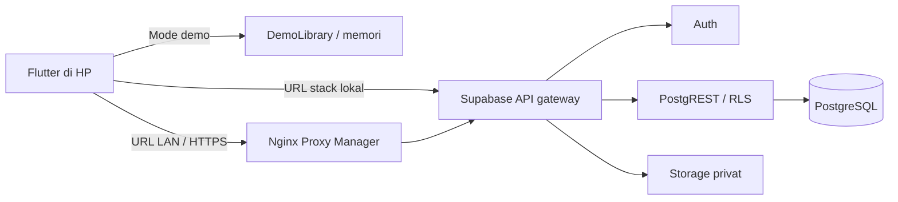

# Arsitektur dan keputusan

Keputusan 28 September 2026: Flutter Android; Supabase self-hosted pada server LAN; Nginx Proxy Manager sebagai reverse proxy; login email + kata sandi; aktivasi anggota oleh admin. Pilihan ini dikonfirmasi pengguna. Domain, alamat server, SMTP, Firebase, serta kebijakan operasional sekolah belum tersedia.

## Implementasi saat ini

- `apps/mobile`: login Supabase; katalog anggota, pengelolaan katalog/inventaris/anggota admin, tinjauan pengajuan admin dan riwayat pinjaman anggota tersedia parsial. Mode demo terpisah dan berlabel.
- `packages/domain`: model buku, eksemplar, siswa, pengajuan, pinjaman dan pemeriksaan kelayakan.
- `packages/data_access`: `DemoLibrary`, penyimpanan sementara dalam memori. Hilang saat proses aplikasi berhenti. Ini bukan implementasi transaksi database atau otorisasi.
- `packages/ui_kit`: lima token warna PRD, tema dan komponen bersama.
- `supabase/migrations`: migrasi identitas/inventaris M2 dan fondasi transaksi/RLS M3. Migrasi transaksi diuji dengan PGlite tetapi belum diterapkan ke server. Form anggota dan alur pengembalian/kehilangan admin belum tersambung.

Transaksi memakai RPC PostgreSQL dan RLS; persetujuan mengunci akun peminjam dan eksemplar, sementara indeks unik parsial menjaga satu pinjaman terbuka per eksemplar. PGlite menguji alur dasar, tetapi Supabase Storage/GoTrue nyata dan konkurensi multi-sesi belum diverifikasi.

Ketika backend tersambung, demo tetap menjadi pilihan build terpisah. Kegagalan jaringan tidak boleh dialihkan otomatis ke demo atau dianggap sukses. Peran berasal dari profil server; pengguna tidak memilih peran ketika login produksi.

Belum tersedia: stack Supabase lokal aktif, form transaksi anggota, pemrosesan pengembalian/kehilangan admin, QR kamera, scheduler retensi, FCM, PDF/CSV dan arsip. Integrasi akun nyata belum diuji end-to-end. Build debug bukan validasi rilis.
