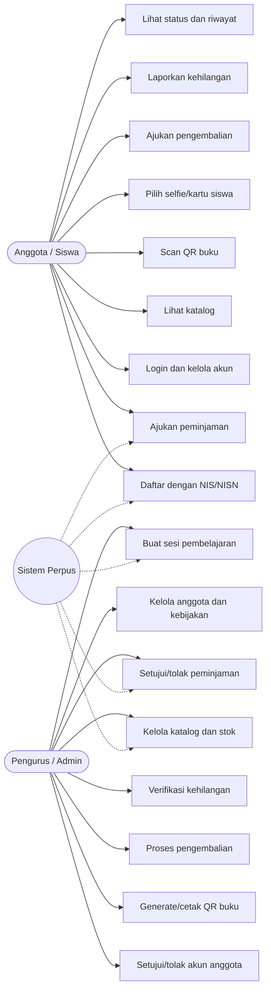
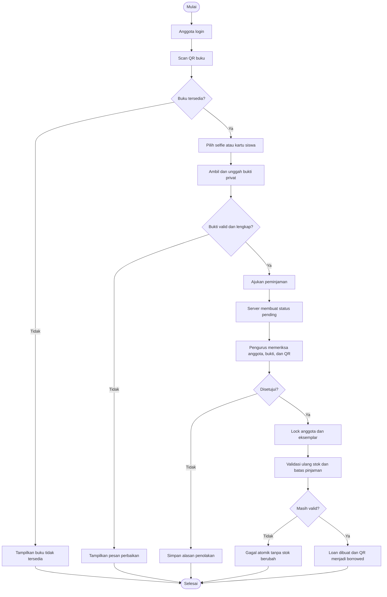
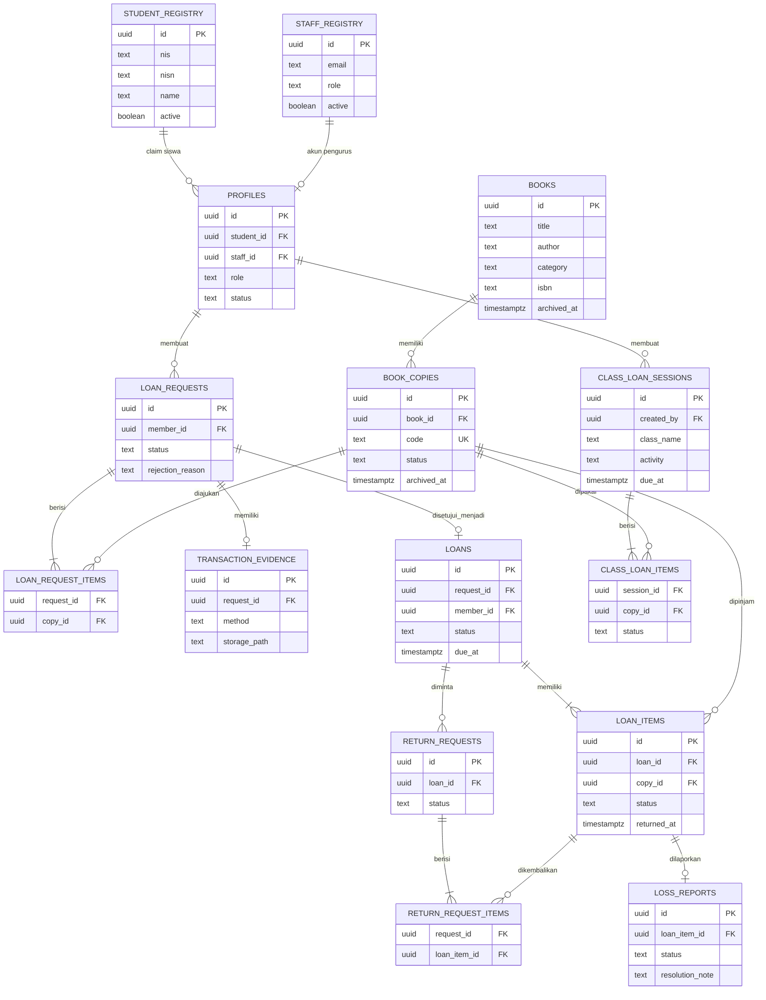
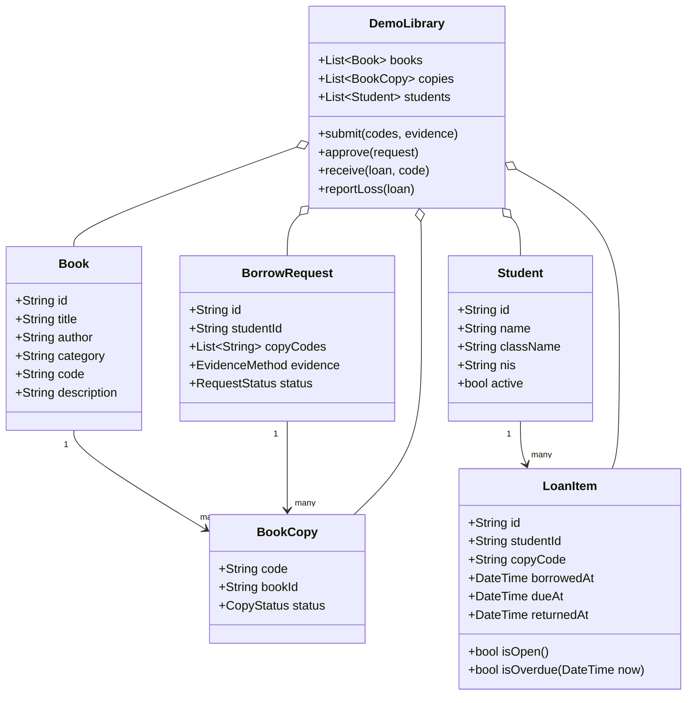
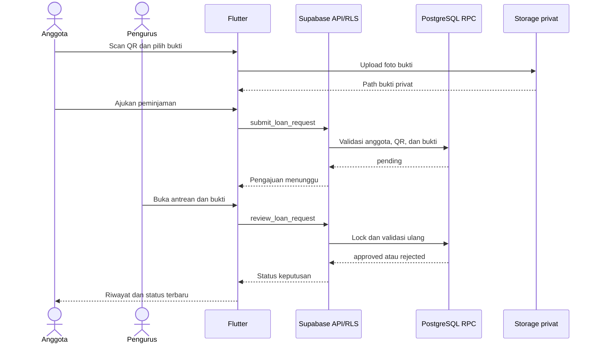
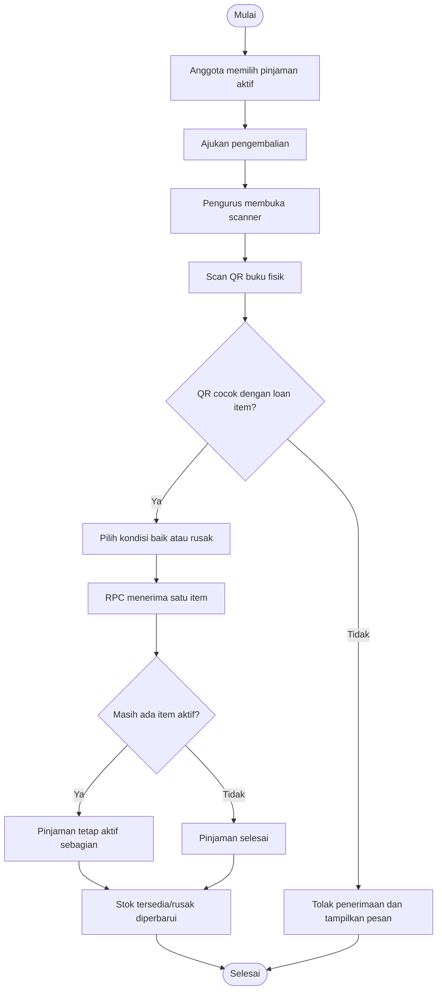
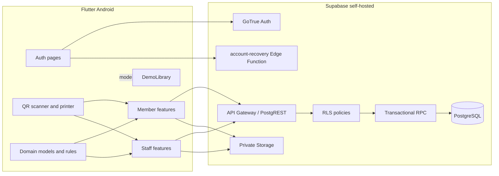
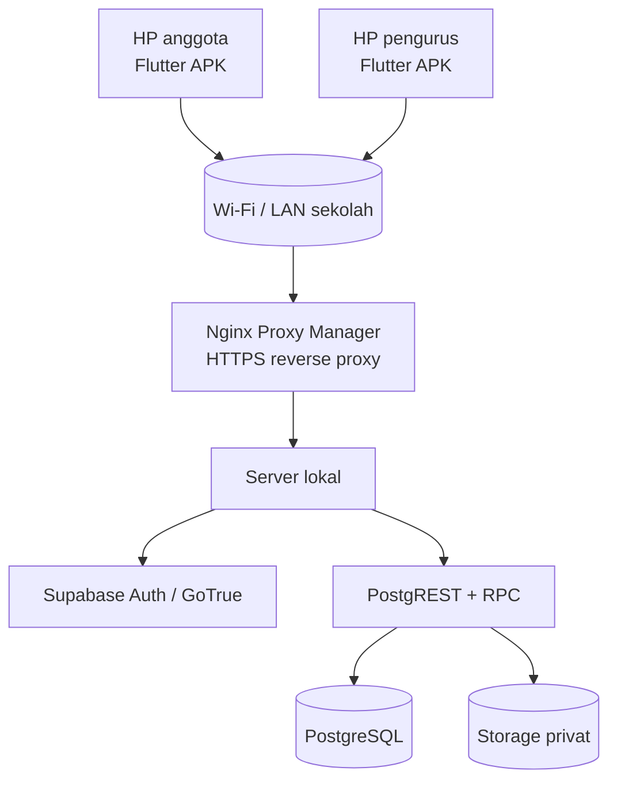

# Diagram Sistem Perpus

Dokumen ini mendeskripsikan struktur dan alur aplikasi Perpus berbasis Flutter dan Supabase self-hosted. Diagram menggunakan Mermaid sehingga dapat dirender di GitHub, GitLab, atau editor Markdown yang mendukung Mermaid.

## 1. Use Case Diagram

## 2. Flowchart pengajuan peminjaman

## 3. ERD basis data

`auth.users`, `storage.objects`, `library_settings`, `audit_logs`, dan `account_recovery_challenges` adalah komponen pendukung Supabase. RLS membatasi akses langsung; perubahan transaksi dilakukan melalui RPC.

## 4. Class Diagram

## 5. Sequence Diagram persetujuan peminjaman

## 6. Activity Diagram pengembalian sebagian

## 7. Component Diagram

## 8. Deployment Diagram

## Batasan dokumentasi

- Diagram menggambarkan arsitektur dan alur yang disepakati; status implementasi tetap mengikuti bukti pada `docs/implementation-status.md` dan laporan E2E.
- Integrasi GoTrue, Storage, dan concurrency PostgreSQL perlu diuji pada lingkungan terisolasi sebelum disebut lulus produksi.
- Demo memakai penyimpanan memori dan tidak boleh digunakan untuk data siswa nyata.
